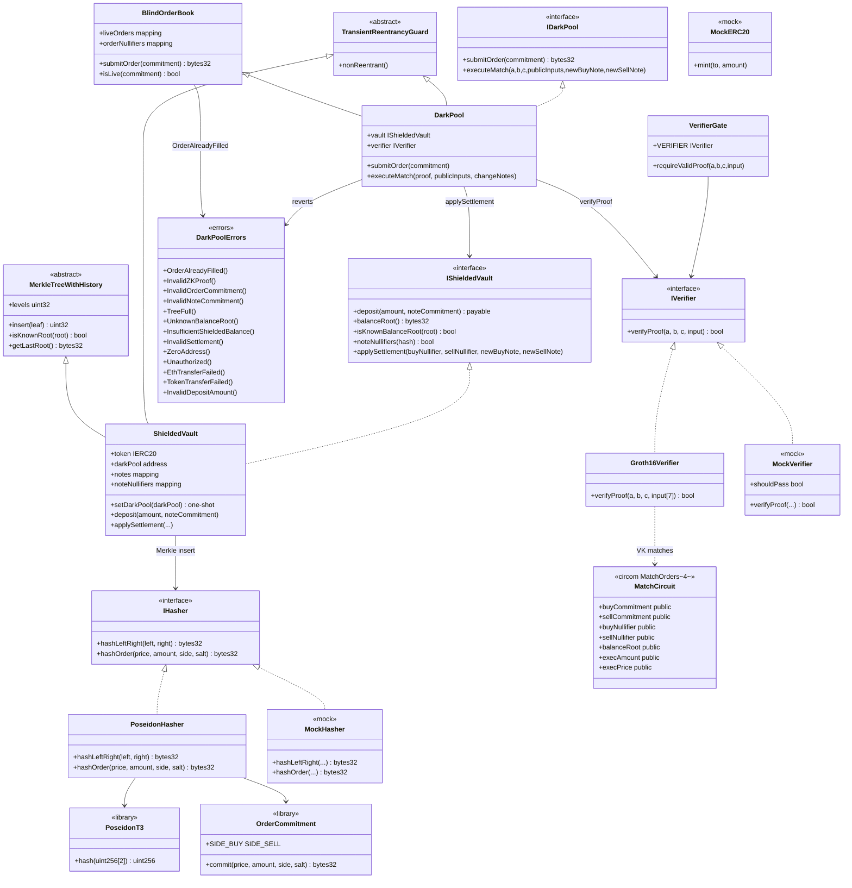

# Class diagram — ZK Dark Pool & Blind Order Book

Structural view of contracts, circuits, libraries, and interfaces (module 21, **v1 closed**).  
**Sync:** 2026-09-15 · API = code · `forge test` → **74 PASS**.

## Diagram (Mermaid)

---

## Key relationships

| Relationship | Description |
|--------------|-------------|
| Trader → Poseidon | `commitment = Poseidon(Poseidon(price,amount), Poseidon(side,salt))` off-chain |
| Trader → DarkPool | Only publishes the commitment; parameters stay hidden |
| DarkPool ⊃ BlindOrderBook | Live orders (`liveOrders`) + `orderNullifiers` |
| DarkPool → Verifier | Match only with a valid Groth16 proof (7 publics) |
| DarkPool → ShieldedVault | `applySettlement` with note nullifiers + change notes |
| Vault → Hasher | Poseidon Merkle (`hashLeftRight`) on deposit / change notes |
| Circuit → Verifier | Publics: commitments, nullifiers, root, execAmount, execPrice |

---

## Design notes (v1)

- **Blind** orders: no `price`/`amount`/`side` on-chain until the match.
- Nullifiers: `orderNullifiers` + `OrderAlreadyFilled()`; notes via `noteNullifiers`.
- Proof: BUY ≥ SELL, membership under `balanceRoot`, `execPrice` in range.
- **Proof-based** settlement (no EIP-712 in v1); only `darkPool` calls `applySettlement`.
- **Per-contract** transient reentrancy (`tstore` xor `address()`): DarkPool → Vault in the same tx.
- Stack: Solidity `0.8.24`, Foundry, Poseidon, Groth16/BN254. Next.js frontend out of v1.
- Decisions / e2e: [`diagrama-de-flujo-EN.md`](./diagrama-de-flujo-EN.md) · [`flujograma-EN.md`](./flujograma-EN.md).
