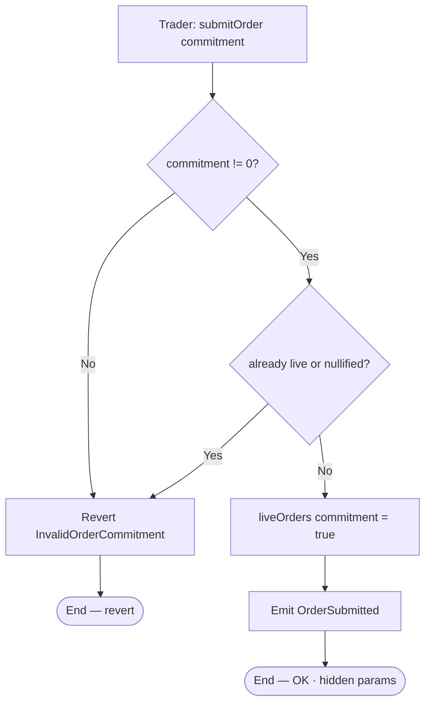
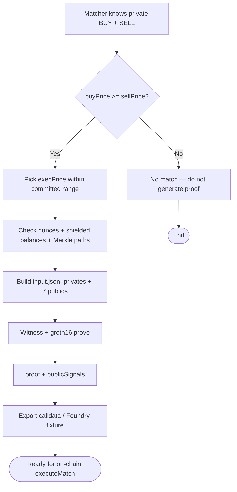
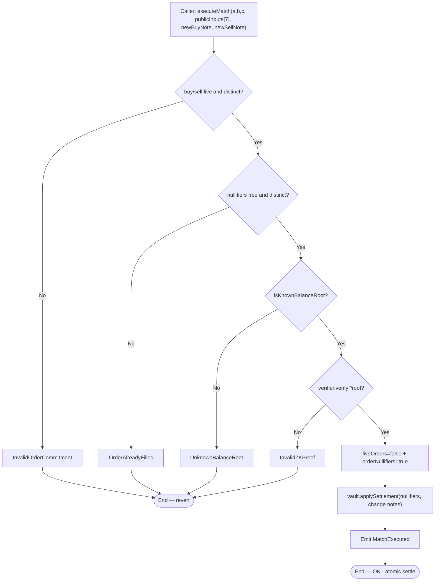
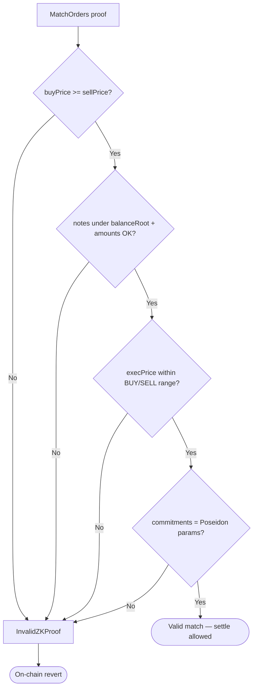
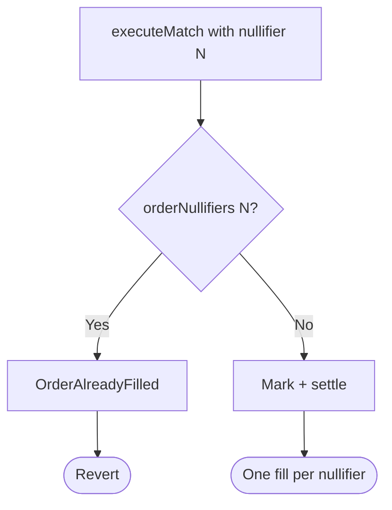
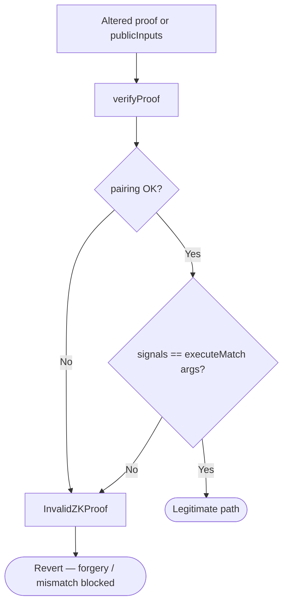
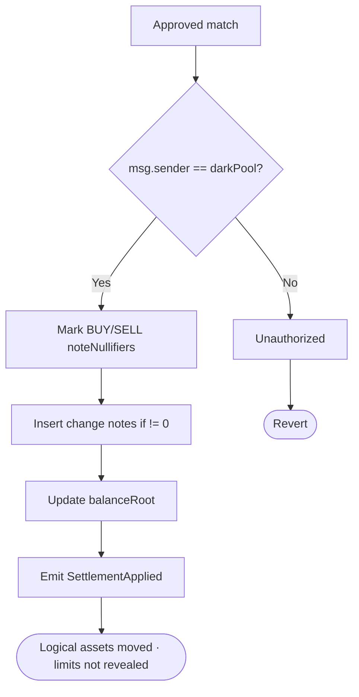

# Flow diagram — Commit, ZK match, and settlement

Internal decision flows of the dark pool, nullifiers, and ZK verification (module 21, **v1 closed**).  
**Sync:** 2026-09-15 · aligned with `DarkPool.executeMatch` / `ShieldedVault`.

## 1. submitOrder (blind commitment)

> Off-chain: `commitment = Poseidon(Poseidon(price, amount), Poseidon(side, salt))`.

---

## 2. Match proof generation (off-chain — Circom / SnarkJS)

---

## 3. executeMatch (checks → proof → effects → settle)

> **CEI (Phase 7):** cheap checks → pairing → mark without re-SLOAD → settle. Per-contract transient `nonReentrant`.

### Publics (`publicInputs[7]`)

| Index | Signal |
|-------|--------|
| 0–1 | `buyCommitment`, `sellCommitment` |
| 2–3 | `buyNullifier`, `sellNullifier` |
| 4 | `balanceRoot` |
| 5–6 | `execAmount`, `execPrice` |

---

## 4. ZK match validation (what the proof shows)

---

## 5. Anti double-fill (order nullifier)

---

## 6. Invalid / tampered proof / price mismatch

---

## 7. Shielded settlement (v1 proof-based)

> v1 does **not** use EIP-712 for payout; binding comes from Groth16 + nullifiers.

---

## Related docs

- UML: [`diagrama-de-clases-EN.md`](./diagrama-de-clases-EN.md)
- E2E: [`flujograma-EN.md`](./flujograma-EN.md)
- Gas / SWC: [`GAS-EN.md`](./GAS-EN.md) · [`SWC-AUDIT-EN.md`](./SWC-AUDIT-EN.md)
- Index: [`README-EN.md`](./README-EN.md)
