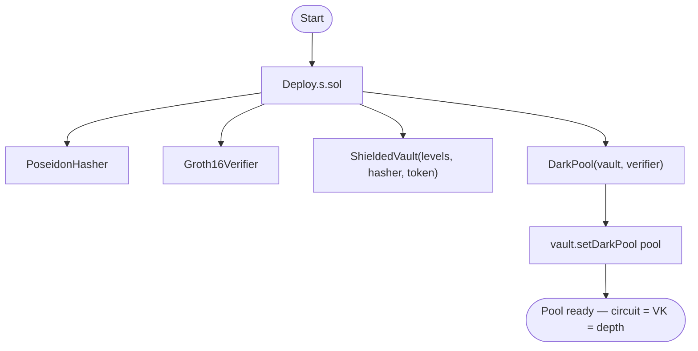
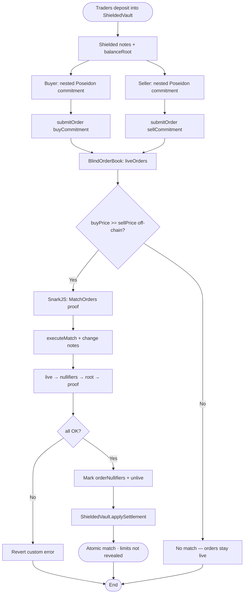
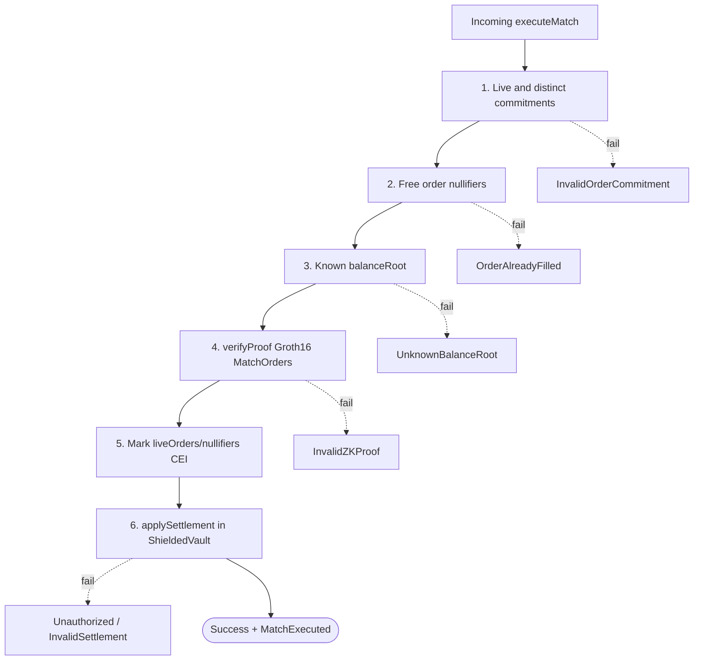
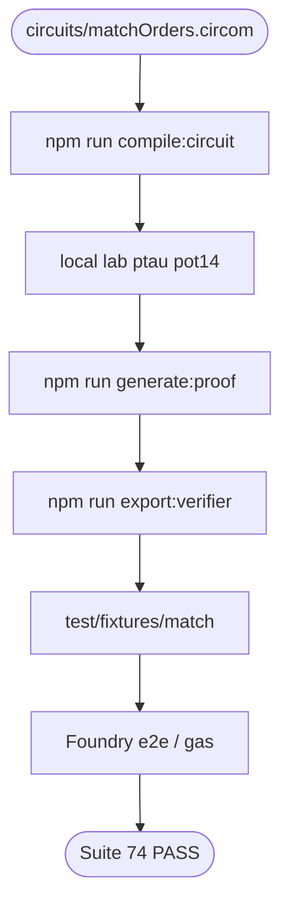
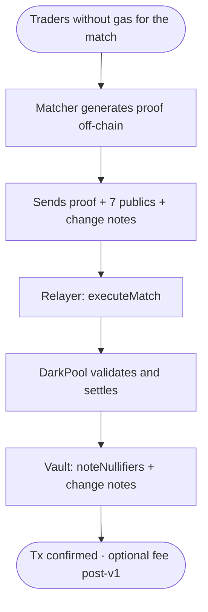

# Flowchart — Full ZK Dark Pool cycle

End-to-end flow between traders, circuit, dark pool, verifier, and shielded vault (module 21, **v1 closed**).  
**Sync:** 2026-09-15 · **74 PASS**.

## Actors

| Actor | Role |
|-------|------|
| Buyer / Seller | Generate `(price, amount, side, salt)`, Poseidon commitment, deposit into the vault |
| Matcher / Relayer | Builds the match witness, generates the Groth16 proof, calls `executeMatch` |
| DarkPool | Blind orders, nullifiers, verify, orchestrates settlement |
| ShieldedVault | Shielded notes, balance roots, `applySettlement` |
| Groth16Verifier | BN254 / Alt_BN128 pairing (`ecPairing` `0x08`) |
| Circom / SnarkJS | `MatchOrders(4)`, fixtures, VK export |
| Deployer | `Deploy.s.sol`: hasher + verifier + vault + pool + `setDarkPool` |
| CI / Foundry | Unit, fuzz, gas snapshot, e2e fixture |

---

## Flowchart — Deploy

> `MERKLE_TREE_LEVELS` must match `MatchOrders(N)` and the exported verifier.

---

## Main flowchart — Deposit → Commit → Match → Settle

---

## Flowchart — Defense layers in executeMatch

---

## Flowchart — Circuit toolchain (lab)

---

## Flowchart — Match via relayer

---

## Happy / failure path matrix

| Scenario | Expected result |
|----------|-----------------|
| `submitOrder` with a valid commitment | Live order + `OrderSubmitted` |
| Valid match proof + BUY ≥ SELL | Settlement + nullifiers marked |
| Same `orderNullifier` twice | `OrderAlreadyFilled` |
| Unknown balance root | `UnknownBalanceRoot` |
| Altered proof / signals | `InvalidZKProof` |
| Price mismatch (BUY < SELL) | No valid proof → `InvalidZKProof` |
| `applySettlement` not from darkPool | `Unauthorized` |
| Deposit with inconsistent amount/msg.value | `InvalidDepositAmount` |

---

## Related diagrams

- Type structure: [`diagrama-de-clases-EN.md`](./diagrama-de-clases-EN.md)
- Internal decisions: [`diagrama-de-flujo-EN.md`](./diagrama-de-flujo-EN.md)
- Phases: [`planificacion-EN.md`](./planificacion-EN.md)
- Gas / SWC: [`GAS-EN.md`](./GAS-EN.md) · [`SWC-AUDIT-EN.md`](./SWC-AUDIT-EN.md)
- Index: [`README-EN.md`](./README-EN.md)
